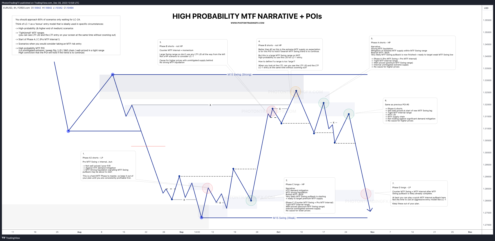
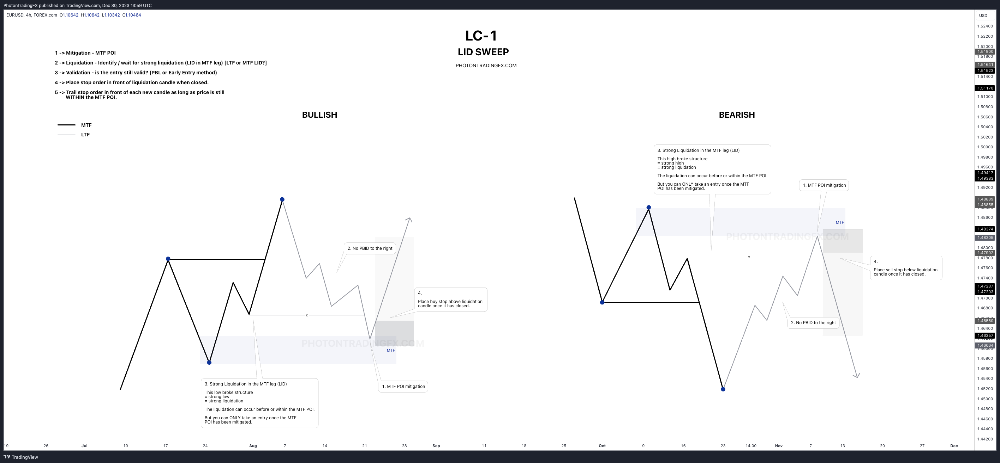
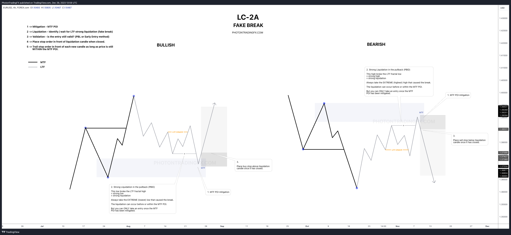
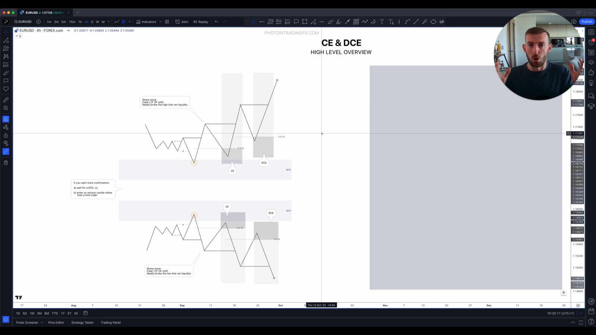
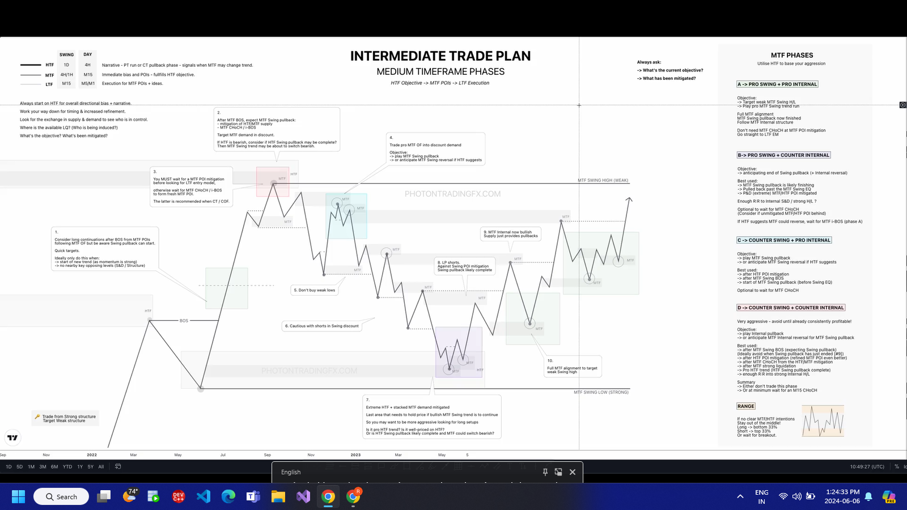

# Swing Trading Plan

### MTF POI SELECTION(1H)

- [ ]  **Led to a break of structure  (CHoCh/i-BOS/BOS)(Mandatory)**
- [ ]  **Unmitigated(Mandatory)**
- [ ]  Swept LQ
- [ ]  Flip
- [ ]  Zone created in session(Swept)
- [ ]  Available Strong LQ to Target (Inducement)
- [ ]  Stacked with HTF Zone
- [ ]  Pricing (P&D)
- [ ]  Correctively zone mitigated
- [ ]  Chain

### LTF EXECUTION(15M)

- [ ]  Mitigation → MTF POI
- [ ]  Liquidation → Identify/wait for strong liquidation ( LC- 2A fake break / LC-1 LID sweep / LC- 2B EQ L/H )
- [ ]  Validation → Early Invalidation method
- [ ]  Place stop order entry in from of liquidation candle (LC) when closed + add buffers
- [ ]  Trail stop order in front of new candle until tagged or MTF POI fails

### LC-2A

- [ ]  small fake-breakout
- [ ]  Early Invalidation valid
- [ ]  near or inside the zone ( optional )
- [ ]  did not close b/a x.( optional )

### LC-1

- [ ]  Range small/Tight
- [ ]  MTF LID
- [ ]  Early Invalidation method
- [ ]  near or inside zone (optional)

### LC-2B

- [ ]  EQ High/Low  formed just before zone
- [ ]  Early Invalidation method

### TRADE MANAGEMENT

- [ ]  Fixed 2R for High SR
- [ ]  No trails or Partials

### RISK MANAGEMENT

- [ ]  Max 2 losses per day
- [ ]  Risk 1% per trade
- [ ]  Pair(s) → USDJPY
- [ ]  No entry < 30 min pre high-impact news
- [ ]  Sessions(s) : 4 pm to - (Sydney) , 7pm to - (Tokyo)

1. What is the overall narrative of HTF(1D,4H) ? 
- [ ]  Pro trend (PT)
- [ ]  Counter trend (CT)
- [ ]  Pro Order Flow (POF)
- [ ]  Counter Order Flow (COF)
- [ ]  HTF & MTF alignment

1. Trend / OF reaction for MTF ?
- [ ]  Continuation
- [ ]  Pullback reaction

1. What structure did it break ?
- [ ]  Fractal
- [ ]  Internal
- [ ]  Swing

1. Did Cause a strong momentum shift (Overwhelming imbalance between S&D)
- [ ]  YES
- [ ]  NO

1. Did Cause a Flip ? 
- [ ]  YES
- [ ]  NO

1. How significant was the zone it flipped ?
- [ ]  Not created
- [ ]  Big
- [ ]  Small

1. Did the POI created sweep zone (took liquidity) ?
- [ ]  YES
- [ ]  NO

1. [I](http://8.IS)s it under priced (P&D)?
- [ ]  YES
- [ ]  NO

1. Stacked with HTF zone ?
- [ ]  YES
- [ ]  NO

10 Part of Chain (Series of mitigation)?

- [ ]  YES
- [ ]  NO

1. Is zone  ?
- [ ]  Fresh(unmitigated)
- [ ]  mitigated but not with clear Price Action
- [ ]  already mitigated

1. Price Delivery to the zone ? 
- [ ]  Corrective
- [ ]  impulsive

1. What is been mitigated ?
- [ ]  pullback objective complete
- [ ]  continuation objective complete

1. Who is in control ?
- [ ]  Supply
- [ ]  Demand

1. Cause for higher /lower prices ?
- [ ]  Weak structure
- [ ]  unmitigated POIs behind
- [ ]  available LQ pools

1. Where was LQ taken ? Where is available LQ ? Who is being induced ? 

- MAPPING
    
    
    **WEEKLY/DAILY →** HTF Perspective
    
    - Map current swing ranges
    - Map relevant SD zones
    - Map relevant liquidity sweeps + pools
    
    **4H →** HTF Narrative
    
    - Map current swing range + P/D
    - Map relevant SD zones
    - Map relevant liquidity sweeps + pools
    
    **M15 →** MTF Immediate Bias
    
    - Map current swing range + P/D
    - Map relevant SD zones
    - Map relevant liquidity sweeps + pools
    
    **M5/M1 →** LTF Execution 
    
    - Wait for >M15 mitigation
    - Trade entry model
    - Follow management plan

| Criteria | Weight (Points) | Reason |
| --- | --- | --- |
| Led to a break of structure | **2** | High impact (shows real intent) |
| Flip (Change of character or OF shift) | **2** | Confirms control has shifted |
| Zone created in session (Swept) | **1** | Adds value, but not mandatory |
| Swept LQ | **2** | Strong liquidity play |
| Strong LQ to Target (Inducement) | **1** | Targeting = extra confluence |
| Stacked with HTF Zone | **2** | MTF alignment is key |
| Pricing (P&D / FVG etc.) | **1** | Adds quality to entry |
| Unmitigated | **1** | Ensures fresh zone |
| Correctively zone mitigated | **1** | Safer entry; no aggressive move |
| Chain (of mitigations) | **1** | Shows POI is part of order flow |

| Grade | Score Range | Label | Description |
| --- | --- | --- | --- |
| 🟢 HP | 11 – 14 | **High Probability** | Strong confluences, stacked confidence |
| 🟡 MP | 7 – 10 | **Medium Probability** | Mixed confluences, could work but riskier |
| 🔴 LP | 0 – 6 | **Low Probability** | Weak or few valid points, avoid |

- ENTRY MODELS
    
    
    
    
    
    
    
    
    
- HIGH PROBABILITY EXAMPLES
    
    
    
    
    
    
    
    
- Phases
    
    
    

Invalid LC-1 Trade

[EURUSD Chart Image](https://www.tradingview.com/x/DZcrgZr5/)

---